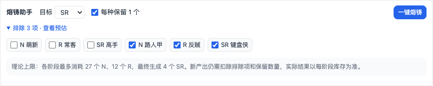

# LINUX SB 扩展工具箱

Chrome Manifest V3 扩展，提供称号统计、分阶段熔铸和称号市场价格提醒。当前版本：**0.12.0**。运行时使用原生 JavaScript，不需要构建。

## 精简后的页面

**称号抽取页**默认只显示积分、收集进度和“更新数据”。详细流水、熔铸评价、库存与缺失称号默认折叠，展开后才生成内容；库存列表限制高度，避免把站点原有内容推到屏幕外。


**称号熔铸页**默认只显示目标 SR/SSR、每种保留一个和执行按钮，并放在站点称号 tab 栏的正下方、原生熔铸内容之前。排除称号与理论预估折叠展示；阶段进度、停止按钮和异常提示保持可见。




以上截图来自本机离线测试页面，使用模拟库存。界面取舍参考 [Laws of UX](https://lawsofux.com/) 中减少同时呈现的选项、降低认知负担和按需展开细节的原则。

## 功能与操作

- **更新数据**：获取最新积分与库存，再同步积分流水和熔铸通知。首次遍历全部可访问分页；已有完整历史且站点提供稳定记录 ID 时，在遇到已知记录页后停止增量扫描。缺少稳定 ID 时自动完整扫描，避免误判重复记录。
- **完整重建历史**：位于抽取页的“详细统计”内。重新遍历站点当前可访问的历史，成功后替换对应数据；某类记录获取失败时保留该类旧数据。通常使用普通“更新数据”即可保留本地已知历史。
- **统计范围**：详细统计显示上次同步时间、历史时间范围和完整性。“完整”指遍历站点当前可访问的历史，不代表站点已经删除的历史仍可恢复。
- **熔铸助手**：按 N→R→SR→SSR 分阶段执行。默认排除「路人甲」「反贼」并每种保留一个。预估明确标为理论上限，实际材料按各阶段当前库存重新计算。
- **阶段校验**：提交后保持“等待结果”，下一次页面载入核对实际材料消耗与目标稀有度增量，核对通过才进入下一阶段。库存变化不符合预期时暂停，不自动重试或继续消耗。
- **停止任务**：每阶段提交前有 3 秒停止窗口。停止只取消后续提交，已经提交的操作仍由站点处理。任务绑定账号和执行标签页，其他标签页不会接管执行；15 分钟后超时。关闭执行标签页后，可以在另一熔铸页停止原任务再重新发起。
- **预算保护**：最低余额与每次抽取确认集中在设置页。普通抽取只统计次数与积分投入；有完整通知的 SSR 熔铸结果才计算六级经验评价。
- **今日免费一抽**：识别免费一抽文案及明确的零积分费用。免费抽取不受最低保留积分限制，仍保留账号校验和用户配置的抽取确认；未标明费用的普通按钮不会被视为免费。
- **抽取前校验**：兼容按钮费用属性和“90 积分”等按钮文字。抽取前单独核对登录账号与最新余额，首次安装不依赖库存或历史同步；确认提交时再次校验，保留实际点击的单抽／十连／百连选项。无法识别账号、余额或费用时分别提示具体原因。
- **弹窗**：按“概况 → 更新 → 页面入口 → 更多设置”的顺序布局；提供抽取、熔铸、我的称号和市场入口，抽取安全设置集中到设置页。
- **市场价格提醒**：在设置页添加称号名称和最高单价，可设置每 5／10／30／60 分钟检查一次。扩展用市场的名称搜索和价格升序筛选在售列表；命中后对同一挂牌去重发送桌面通知。点击通知打开筛选后的市场页面，由用户自行确认购买。弹窗显示监控状态、规则和最近检查结果；设置页也可立即检查。

抽取与熔铸模块只在 `/gacha` 和 `/gacha_forge_center` 注入。市场检查在扩展的隐藏后台文档中发起，不会自动打开市场标签页；浏览器需要保持运行，且论坛账号需要保持登录。点击通知时才打开市场页面。没有自动购买或发布交易的代码。

## 本地数据与升级

- 设置由后台串行处理并按字段更新；调整预算不会覆盖熔铸偏好。
- 积分、库存、流水、通知和熔铸任务按账号隔离。账号从顶部账户区或个人侧栏的“我的积分／我的通知”等入口识别，不从帖子作者链接推测身份。
- 无法确认登录账号、页面结构或最新库存时会提示错误并保留旧数据。站点改版后可能需要更新解析规则。
- 旧版本中带用户编号的数据自动迁移；没有用户编号的旧数据保留为未归属备份，不自动分配给新账号。旧版未绑定账号/标签页的熔铸任务不会恢复。
- 清除统计只影响设置页显示的账号，保留其库存与积分；清除前已经启动的同步结果不会重新写回。
- 称号数据和设置保存在 `chrome.storage.local`。旧版图床配置仍留在本地扩展存储中，但新版本不会读取或使用它。
- 市场规则和最近检查结果也保存在本地。监控绑定首次扫描时的登录账号；若登录账号变化，检查会报错，关闭再开启监控即可绑定新账号。

## 加载与验证

1. 打开 `chrome://extensions` 并开启开发者模式。
2. 选择“加载已解压的扩展程序”，选择本目录。
3. 更新代码后，在扩展管理页重新加载扩展，再刷新已打开的论坛页面。

单元测试和 DOM 交互测试：

```bash
npm ci
npm test
```

完整浏览器验证（隔离的临时配置，不使用个人浏览器账号）：

```bash
npx playwright install chromium
npm run test:browser
```

也可通过 `PLAYWRIGHT_CHROMIUM_EXECUTABLE` 指向已有的 Chromium 测试浏览器。浏览器测试禁用 DNS 并拦截请求，以本地页面模拟库存、账号、市场挂牌和提交结果，覆盖桌面/窄屏布局、真实扩展设置、市场通知及熔铸成功/失败/停止，不进行真实购买、抽取或熔铸。

## 后续扩展位置

- `lib/state.js`：共享默认值、账号快照、历史合并和消息接口。
- `lib/store-worker.js`：后台串行保存、迁移、账号隔离和熔铸任务状态转换。
- `lib/parser.js`：站点 DOM 解析、统计计算及材料规划。
- `lib/history.js`：分页发现、完整扫描与增量边界。
- `lib/forge.js`：熔铸阶段定义与库存结果校验。
- `content.js`：称号页交互、精简面板及流程协调。
- `background.js`：加载共享状态和后台存储逻辑。
- `lib/market.js` / `market-offscreen.js` / `lib/market-worker.js`：市场列表解析、后台只读查询、定时检查和通知。

增加新设置时先在共享默认值中声明，调用局部更新接口；增加账号数据时通过后台存储接口保存，不在页面中整份覆盖状态。涉及提交材料的改动需要同时验证成功、失败、账号变化、多标签页和停止场景。
